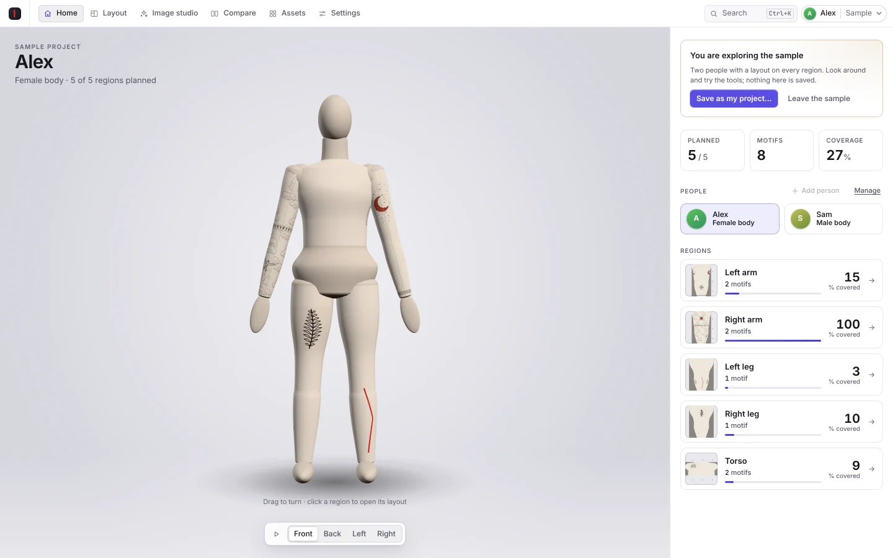
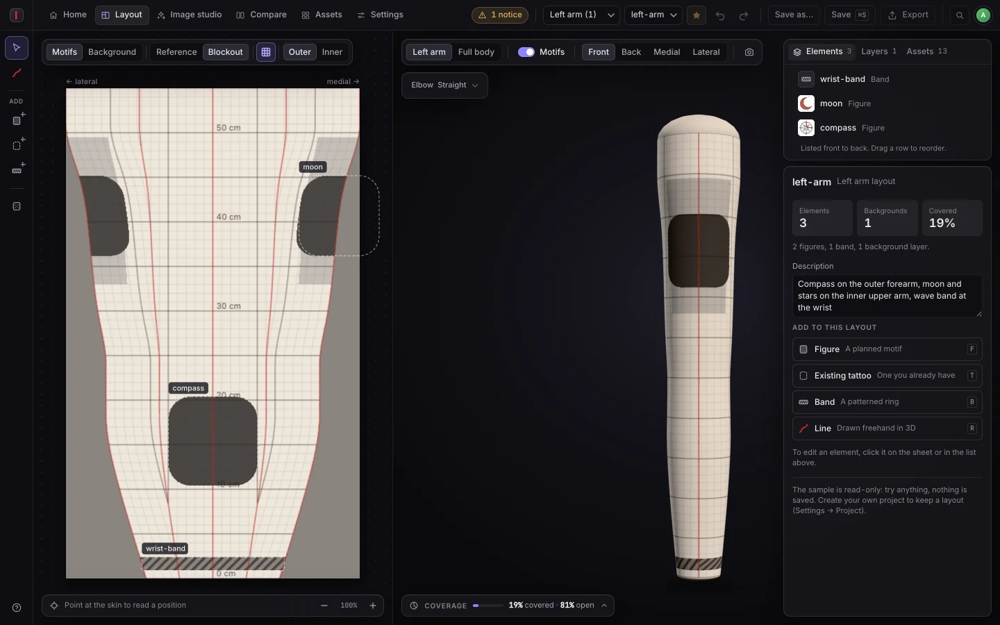
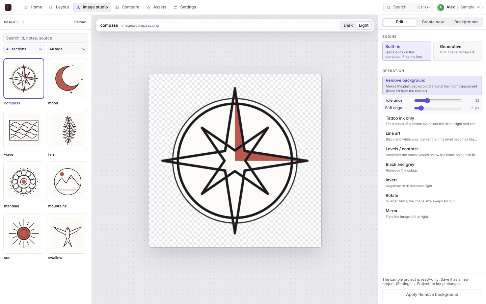
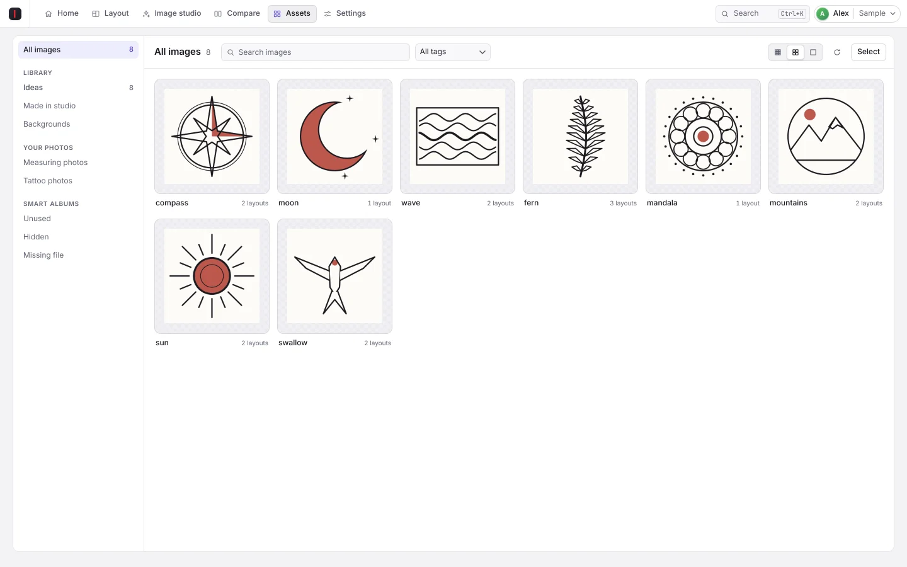
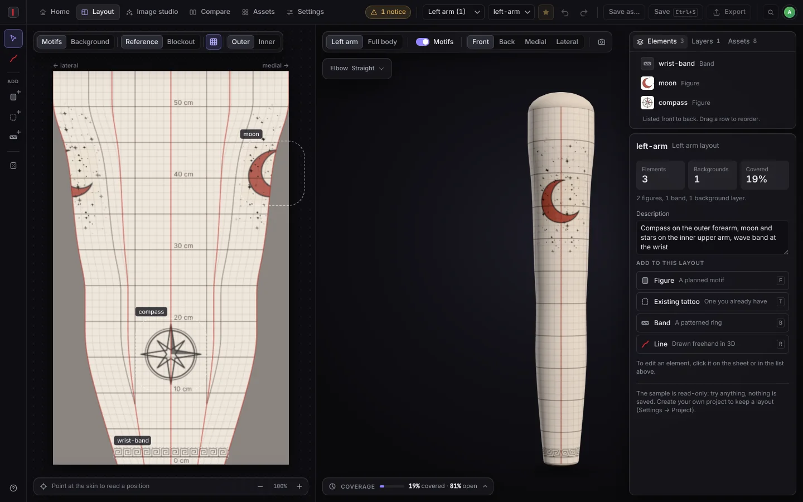

# Tattoo Planner

[](https://github.com/jd13381/tattoo-planner/actions/workflows/ci.yml)
[](https://github.com/jd13381/tattoo-planner/actions/workflows/security.yml)
[](https://scorecard.dev/viewer/?uri=github.com/jd13381/tattoo-planner)
[](LICENSE)

Plan a tattoo on a 3D body before you see the artist: place images, patterns, bands and lines on a 2D unwrap of an arm, a leg or the torso, see them live in 3D, and export a PDF handout. The output is a **sketch, not a finished design**: the artist designs the tattoo. Everything runs locally on your computer.

> [!NOTE]
> **Personal project, published as is.** I built it to plan my own sleeve and I'm not actively developing it. Issues and pull requests are not accepted. You're welcome to fork it and build on it under the [MIT licence](LICENSE).


## What it does



- **Home:** the whole body of the current person with every region's active layout on a turntable; click a region to edit it. A project can hold **several people** (for example you and your partner), each with their own body, measurements, layouts and photos, sharing one idea library.
- **Body regions:** left and right arm, left and right leg, torso, on a female or male sample body; your own measurements (optional, with a measuring wizard) adjust it.
- **Layout editor:** figures (reference images), existing tattoos, bands and freehand lines on a 2D unwrap, over background layers (clouds, stars, patterns, tileable images); drag, resize, rotate, layer, undo. The 3D view follows every change, also with the elbow bent and as a full body.
- **Blockout and reference modes**, a cm grid, and **coverage** per zone (how much skin stays open).
- **Compare** two variants side by side.
- **Existing tattoos** projected onto the body from a few photos (guided setup); only the ink goes onto the skin.
- **Image studio:** clean up a reference image with built-in operations (background removal, line art, levels …), or redraw it with OpenAI's GPT Image using your own key.
- **Handout:** a PDF with every view, the unwrap, an element table and the open points, plus PNGs, saved into your project folder.

| Blockout and coverage                                   | Image studio                                                     |
| ------------------------------------------------------- | ---------------------------------------------------------------- |
|  |               |
| **Asset library**                                       | **Dark theme**                                                   |
|           |  |

The screenshots show the sample project that ships with the planner (its motifs are drawn placeholders) and are generated by `npm run screenshots`.

## Download for macOS

No need to clone anything: get the DMG for Apple Silicon or Intel from the **[latest release](https://github.com/jd13381/tattoo-planner/releases/latest)** and drag the app into Applications.

The app is not signed with a paid Apple Developer ID, so macOS blocks it the first time. You allow it once in **System Settings → Privacy & Security → Open Anyway**. [docs/install-macos.md](docs/install-macos.md) explains why and walks through it for each macOS version, and how to check the download (checksums, build provenance).

## Run it from source

You need Node ≥ 22.18 and npm.

```sh
git clone https://github.com/jd13381/tattoo-planner.git
cd tattoo-planner
npm ci              # install (install scripts are disabled by .npmrc)
npm run dev         # http://127.0.0.1:4320 in a current Chrome, Edge or Firefox
```

Or as a desktop app from the checkout: `npm run desktop` builds and opens it (the first run downloads Electron, about 100 MB).

On the start screen, **Explore the sample** opens a ready-made, read-only project with two people; or create your own project folder.

## Bring your own key

Generative image edits use OpenAI's GPT Image with **your own API key** (Settings → Image generation, or `TATTOO_OPENAI_API_KEY` in a `.env` file). Each request is billed to your OpenAI account and shows a rough cost first. Without a key, everything else works the same, including the built-in image operations.

## Your project and privacy

A project is one folder you choose (YAML files and images: layouts, measurements, the image catalogue, exports). The planner's server listens on `127.0.0.1` only; there is no account, cloud storage or telemetry. Only a generative image edit that you start sends the image and your instruction to OpenAI, with your key; with a key set, the planner also checks it once at start (no images, can be switched off). Details: [docs/privacy.md](docs/privacy.md).

## How it was made

The planner was built in a couple of weeks with [Claude Code](https://claude.com/claude-code), starting from my plan for one sleeve and growing into a general tool. The history is left as it happened. [`PROJECT_BRIEF.md`](PROJECT_BRIEF.md) is the original brief, [docs/adr/](docs/adr/) records the technical decisions, [docs/claude-decisions.md](docs/claude-decisions.md) the decisions Claude made for my review, and [docs/product/roadmap.md](docs/product/roadmap.md) the product plan.

## Quality and security

Every push and pull request runs lint, typecheck, unit tests and an end-to-end smoke test in Chromium, plus a security pipeline: **CodeQL** (SAST) on the code and the workflows, **Gitleaks** secret scanning, **npm audit** with registry signature checks, a **CycloneDX SBOM**, dependency review, **zizmor** for the GitHub Actions workflows, and an **OWASP ZAP** baseline scan (DAST) against the running app. All actions are pinned to commit SHAs with least-privilege tokens; **OpenSSF Scorecard** rates the result. Details: [docs/adr/0027-ci-security-pipeline.md](docs/adr/0027-ci-security-pipeline.md), [SECURITY.md](SECURITY.md).

## Documentation

- [docs/usage.md](docs/usage.md): feature reference (every tab, the project folder, image generation, patterns, export, layout fields, configuration files).
- [docs/development.md](docs/development.md): setup, desktop builds, the server API, commands, code layout and UI conventions.
- [docs/measuring.md](docs/measuring.md): how to measure and photograph an arm (German).
- [docs/research/local-image-models.md](docs/research/local-image-models.md): local image models as an alternative to GPT Image, with a benchmark in `benchmark/local-image-models/`.

```sh
npm run check       # lint, typecheck, tests and the binary guard
```

## Licence

[MIT](LICENSE).
