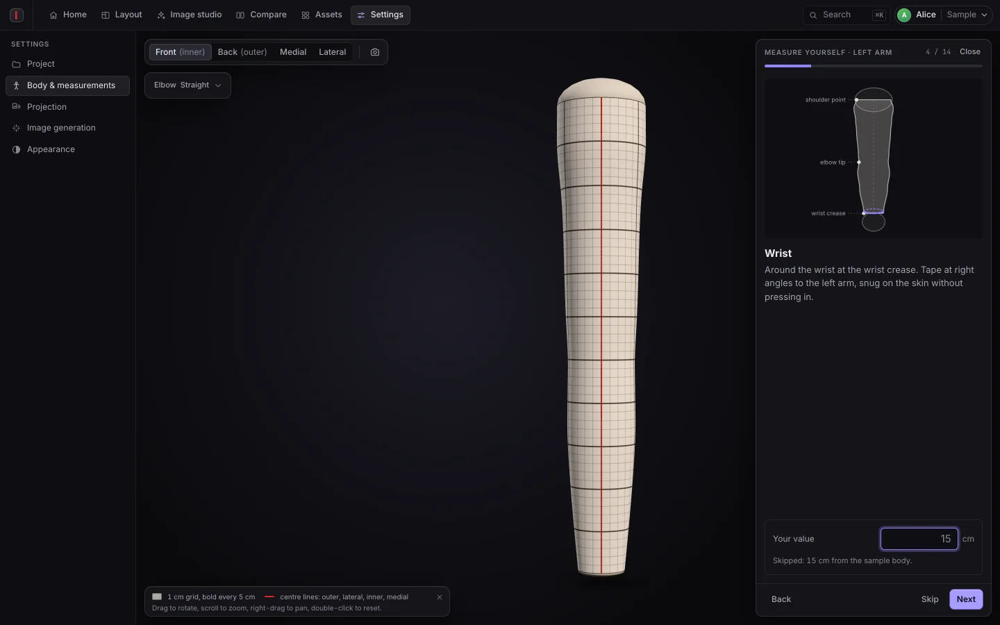
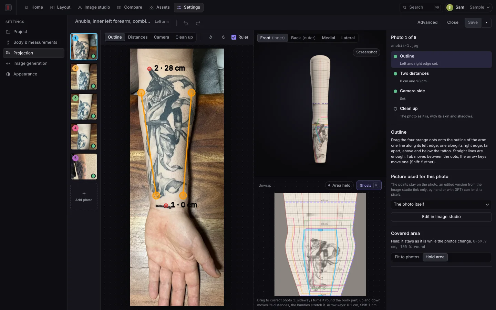

<div align="center">

# Tattoo Planner

### See your next tattoo on your body before it's on your skin.

Sketch on a flat sheet, watch it wrap around a 3D body built to your measurements, redraw references with AI, and walk into the studio with a clear brief.

[](https://github.com/jd13381/tattoo-planner/actions/workflows/ci.yml)
[](https://github.com/jd13381/tattoo-planner/actions/workflows/security.yml)
[](https://scorecard.dev/viewer/?uri=github.com/jd13381/tattoo-planner)
[](LICENSE)

**[Download for macOS](https://github.com/jd13381/tattoo-planner/releases/latest)** · [Run from source](#run-it-from-source) · [Get an OpenAI key](docs/openai-key.md)

</div>


> [!NOTE]
> **Personal project, published as is.** I built it to plan my own sleeve and I'm not actively developing it. Issues and pull requests are not accepted. Fork it and make it yours under the [MIT licence](LICENSE).

---

## 🎨 Bring your key, build your own design


Found a motif you love but it's not quite _you_? The **Image studio** turns references into your own design. Tell GPT Image what to change, in plain words and any language: _"make it fine-line"_, _"remove the background"_, _"add a red triangle like in this reference"_. Get several variants side by side, keep the best one, and drop it straight onto your body.

- **Bring your own OpenAI key.** You pay OpenAI directly, a few cents per image. No subscription, no middleman, no account here. [Get a key in five minutes](docs/openai-key.md).
- **No key? Still useful.** Background removal, line art, levels, black and grey, rotate and mirror run right on your computer, free.

## 📏 Measured to your body, centimetre for centimetre



A tattoo that looks great on a generic mannequin can look completely different on your forearm. A step-by-step **measuring wizard** takes you through wrist, forearm, elbow, biceps and shoulder with a tailor's tape, and the 3D body reshapes to match. Every grid line is a real centimetre, so a 12 cm motif is 12 cm on screen and 12 cm on you.

Arms, legs and torso, on a female or male base body. Skip any value and the sample body fills in.

## 🪞 See how it would look on you



Your new piece has to work with the ink you already have. Take one to four photos of an **existing tattoo**, mark its outline and two distances, and the planner **projects it onto the 3D body**, wrapped around the arm the way it really sits. Then plan the new motifs around it and see the whole sleeve together.

## 🧭 Plan the whole piece


- **Layout editor:** place figures, bands, freehand lines and background layers (clouds, stars, patterns) on a flat unwrap; drag, resize, rotate, layer, undo. The 3D view follows every change, also with the elbow bent and as a full body.
- **Blockout and coverage:** switch to blockout to judge the balance of ink and open skin, with the coverage per zone in numbers.
- **Compare** two variants side by side on the same body.
- **Several people in one project**, each with their own body, measurements and layouts.
- **Handout for your artist:** one click exports a PDF with every view, the unwrap and an element table. It's a sketch, not a stencil: your artist still designs the tattoo.


## 🔒 Private by default

Everything runs on your computer. No account, no cloud, no tracking, no update check. Your photos and designs stay in a project folder you choose. The only thing that ever leaves your machine is a generative edit you start yourself, sent to OpenAI with your own key. [What exactly is sent](docs/privacy.md).

---

## Download for macOS

Get the DMG for Apple Silicon or Intel from the **[latest release](https://github.com/jd13381/tattoo-planner/releases/latest)** and drag the app into Applications. No cloning, no terminal.

The app isn't signed with a paid Apple Developer ID, so macOS blocks it the first time: allow it once in **System Settings → Privacy & Security → Open Anyway**. [docs/install-macos.md](docs/install-macos.md) explains why and walks you through it, including how to check that the download is genuine.

## Run it from source

You need Node ≥ 22.18 and npm.

```sh
git clone https://github.com/jd13381/tattoo-planner.git
cd tattoo-planner
npm ci              # install (install scripts are disabled by .npmrc)
npm run dev         # http://127.0.0.1:4320 in a current Chrome, Edge or Firefox
npm run desktop     # or as the desktop app (downloads Electron once, about 100 MB)
```

On the start screen, **Explore the sample** opens a ready-made, read-only project; or create your own project folder. The screenshots above show that sample (its motifs are drawn placeholders) and are generated by `npm run screenshots`.

## Built with care

- **Stack:** TypeScript, React 19, three.js via React Three Fiber, Vite, a small Node server, Electron for the desktop app. Geometry, unwrap maths and schemas are framework-free modules with unit tests.
- **Quality gates on every change:** lint, typecheck, unit tests on Node 22 and 25, and an end-to-end smoke test in Chromium.
- **Security pipeline:** **CodeQL** (SAST) on the code and the workflows, **Gitleaks** secret scanning, **npm audit** with registry signature checks, a **CycloneDX SBOM**, dependency review, **zizmor** for the GitHub Actions workflows and an **OWASP ZAP** baseline scan (DAST) against the running app. Actions are pinned to commit SHAs with least-privilege tokens; **OpenSSF Scorecard** rates the result. [ADR 0027](docs/adr/0027-ci-security-pipeline.md), [SECURITY.md](SECURITY.md).
- **Releases from CI:** DMGs built by GitHub Actions with checksums and signed build provenance. [ADR 0028](docs/adr/0028-unsigned-dmg-release.md).

## How it was made

Built in about two weeks with [Claude Code](https://claude.com/claude-code), starting from my plan for one sleeve and growing into a general tool. The history is left as it happened: [`PROJECT_BRIEF.md`](PROJECT_BRIEF.md) is the original brief, [docs/adr/](docs/adr/) records the technical decisions, [docs/claude-decisions.md](docs/claude-decisions.md) the calls Claude made for my review, and [docs/product/roadmap.md](docs/product/roadmap.md) the product plan.

## Documentation

- [docs/usage.md](docs/usage.md): every tab and feature, the project folder, image generation, export.
- [docs/openai-key.md](docs/openai-key.md): getting an OpenAI API key, step by step.
- [docs/install-macos.md](docs/install-macos.md): installing the DMG.
- [docs/development.md](docs/development.md): setup, desktop builds, the server API, commands, code layout.
- [docs/measuring.md](docs/measuring.md): how to measure and photograph an arm (German).

## Licence

[MIT](LICENSE). Use it, fork it, build your own.
